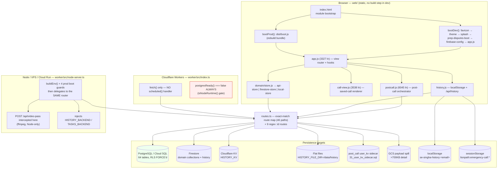
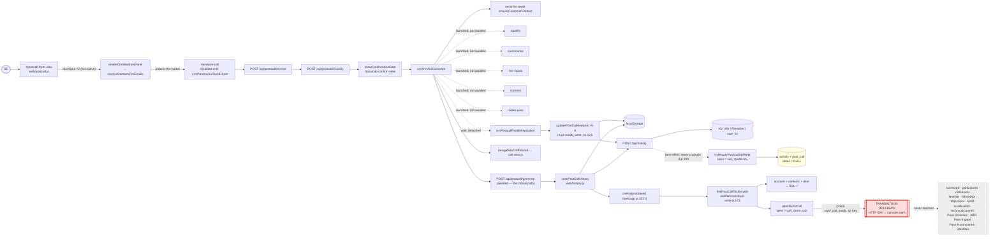

# 01 — As-Built System Architecture

**Snapshot audited:** `SE-Labs` @ `c58eac930f8676e73a8406b9909c87b3f179b21c`, branch `main`, `VERSION` 2.1.30, 2026-09-08.
**Evidence level:** CODE-PROVEN throughout unless a row says otherwise. Runtime configuration of deployed environments is **not** available — see [05-runtime-sql-verification](05-runtime-sql-verification.md) §1.
**Related:** [_evidence-index](_evidence-index.md) · [02-postcall-dag](02-postcall-dag.md) · [04-sql-persistence-map](04-sql-persistence-map.md) · [06-bugs-and-risks](06-bugs-and-risks.md)

---

## 1. Snapshot facts that contradict the brief

| Claim in the audit brief | Actual | Impact |
|---|---|---|
Commit `c58d78d34c5d…` | `c58eac930f86…` | citations in this audit use the real HEAD |
"archive does not appear to contain `.git`" | `.git` **is** present; branch `main` tracks `origin/main` | full history is available |
Repo root = working directory | repo is at `<cwd>/SE-Labs` | all paths in this audit are relative to `SE-Labs/` |
~203k lines / ~871 files | ~204k lines / ~967 in-scope files | close enough; recalculated in [_audit-state](_audit-state.md) §3 |
`VERSION` 2.1.30 | confirmed | — |

Two further contradictions worth naming:

- **`main` is probably not what production runs.** `.cursor/rules/push-antony-2.1.mdc` (`alwaysApply: true`) states the production VPS deploys from branch `2.1` pushed to a *different* remote (`antonyanbu25/lionpath_V2`). Nine remote branches exist. Any statement about "production" derived from `main` is an inference.
- **`worker/wrangler.toml` has an uncommitted `compatibility_flags = ["nodejs_compat"]`** (`E-002`). The committed file lacks it. Since the worker imports Node built-ins transitively (`pg`, `node:fs`, `child_process`), the *committed* Cloudflare config would not run the current code — strong evidence that Cloudflare is no longer the live target.

---

## 2. Deployment topology (current, by target)



### 2.1 Browser entry points

Exactly one HTML entry (`web/index.html`) with a `<script type="module">` bootstrap at `:1017`. It branches on hostname:

```js
const PROD_HOST =
  /^(portal|yonus|janus|lionpath)\.benjaminsquare\.com$/.test(location.hostname) ||
  /\.run\.app$/.test(location.hostname);
const useBundle = PROD_HOST || new URLSearchParams(location.search).has("bundle");
```

- `bootProd()` → `import("./dist/boot.js")` — a single esbuild bundle.
- `bootDev()` → five sequential dynamic imports, each cache-busted with a **hardcoded, drifting** version string: `splash.js?v=2.1.17`, `prep-disputes-boot.mjs?v=2.1.14`, then `app.js?v=${MODULE_BUILD}`. With `VERSION` at 2.1.30, two of those query strings are 13–16 patch releases stale — harmless for correctness, but it means dev and prod do not load byte-identical graphs, so a prod-only bundling bug is structurally possible.

Other HTML in `web/` (`about.html`, `qc-preview.html`) and the four prototype pages at the repo root are **not** part of the app graph.

### 2.2 Worker entry points

Both targets share **one** router. `node-server.ts:7` does `import worker from "./index"` and `:288` calls `worker.fetch(request, env)`. There is therefore **no route registered on one target and absent on the other** — every divergence is behavioural, listed in §4.

Route matching is a two-level plain-object lookup (`routes[pathname][method]`, `routes.ts:3298-3340`; dispatch at `index.ts:110-115`), plus:
- one hardcoded `if` for `/api/admin/impersonate-token` (`index.ts:118`)
- a regex for `PATCH|DELETE /api/tasks/:id` (`index.ts:125`)
- `dispatchDomainReadById` — 6 regex routes (`routes/domain-reads.ts:364-384`)
- `dispatchReadModelsById` — 1 regex route (`routes/read-models.ts:99`)

**No trailing-slash tolerance, no prefix matching, no path normalisation.** `/api/history/` is a 404.

---

## 3. Dead HTTP surface — handlers that exist but are unreachable

Negative proof method: for each symbol, an exhaustive `grep -rn '<symbol>\|<module>' worker/src` was run and compared against the verbatim route map at `routes.ts:3298-3340`. All of these have **zero** importers outside their own definition file.

| Intended path | Handler | Who calls it in production | Consequence |
|---|---|---|---|
`GET /api/health`, `/api/health/live`, `/api/health/ready` | `routes/health.ts:129,79,89`; `healthRoutes:138` | `deploy/cloudrun/README.md:21` configures Cloud Run **liveness and readiness probes** against these paths | Probes 404. `E-043` |
`POST /api/read-models/schedule` | `routes/read-models.ts:33` | **the browser**, `web/domain/read-models-service.js:76` | Read-model scheduling silently never happens. `E-044` |
`POST /api/internal/batch/enqueue` | `routes/internal-batch.ts:96` | `deploy/vps/cron-batch.sh:37` (an **active** cron script) | Nightly embedding backfill 404s. `E-045` |
`POST /api/internal/read-models/nightly-rebuild` | `routes/internal-batch.ts:204` | `deploy/vps/cron-batch.sh:38`, `deploy/cloudrun/cloud-scheduler.example.sh:37` | Nightly read-model rebuild 404s. `E-045` |
`POST /api/internal/batch/poll`, `/fallback`, deal-grace-sweep | `routes/internal-batch.ts:161,182,263` | nothing | Gemini **batch** summary path (Pass 9 batch) is unreachable → **DEAD PATH** |
`GET /api/admin/llm-usage` | `routes/admin-llm-usage.ts:91` | nothing | no cost dashboard |
director analytics | `routes/analytics.ts:11` | nothing | — |

`verifyInternalCronAuth` survives only because `routes/internal-outbox.ts:14` imports it. `rate-limit.ts:131-142` still exempts `/api/health*` — an exemption for paths that 404.

The one internal job route that IS registered — `POST /api/internal/outbox/project` (`routes.ts:3339`) — is called by **nothing** in `deploy/`. So `sync_outbox` has a working endpoint and no scheduler.

---

## 4. Runtime configuration truth table

The single most consequential finding in this document: **`PERSISTENCE_MODE` is read three different ways with three different defaults, in the same request.**

| Reader | Expression | Default when unset | Used for |
|---|---|---|---|
`resolvePersistenceMode` (`types.ts:34-42`) — the *canonical* helper, whose docstring explains the intended `sql` default | `env?.PERSISTENCE_MODE \|\| process.env.PERSISTENCE_MODE \|\| "sql"` | **`"sql"`** | **only** `fallback-log.ts:80` (the logger) |
`resolvePersistencePort` (`dual-write-repository.ts:357`) | `env.PERSISTENCE_MODE \|\| process.env.PERSISTENCE_MODE \|\| "sql"` | **`"sql"`** | which repository object to build |
`handleDomainWrite` (`routes.ts:1652`) | `(env.PERSISTENCE_MODE \|\| "").trim()` | **`""`** | the Firestore-admin requirement **and the 501 "mode guard"** |

Consequence, when `PERSISTENCE_MODE` is unset (Cloudflare and default Cloud Run):
1. `resolvePersistencePort` returns a `PostgresRepository`;
2. but `handleDomainWrite` sees `mode === ""`, so `mode !== "sql"` → it **requires Firestore admin** (503 without it) and **does not fire the 501 mode guard**;
3. any method with no SQL path therefore falls through to `applyDomainWrite` → **Firestore**.

That is precisely the failure mode `types.ts:20-29` says was eliminated:

> that path was the exact mechanism that let real post-call/pre-call writes go missing from Postgres without anyone noticing

**The mode guard is inert unless an operator explicitly sets `PERSISTENCE_MODE=sql`.** No shipped deployment file does.

### 4.1 Per-target matrix

| Runtime / target | Entry point | Build artefact | `PERSISTENCE_MODE` source → effective | `PERSISTENCE_READ_MODE` | `HISTORY_BACKEND_MODE` | Firestore required? | PostgreSQL possible? | History backend | Evidence |
|---|---|---|---|---|---|---|---|---|---|
**Cloudflare Workers** | `worker/src/index.ts:66` `fetch` | `wrangler` bundle from `src/index.ts` | `wrangler.toml [vars]` sets **no** `PERSISTENCE_MODE` → `handleDomainWrite` sees `""`; port sees `"sql"` | unset → `persistenceReadReady()` false → Firestore reads | unset; `HISTORY_BACKEND` is **never injected** on this target | **YES** (mode ≠ `sql`) | **NO — never.** `postgresReady()` returns `false` on `!isNodeRuntime()` | `HISTORY_KV` binding, whose id in `wrangler.toml:40` is the placeholder `0000…0001` | `E-049`, `E-050`, `postgres-pool.ts:28-32`, `wrangler.toml:37-41` |
**VPS (Docker Compose)** | `worker/src/node-server.ts:288` | `deploy/vps/Dockerfile.worker` | `docker-compose.yml:28` `PERSISTENCE_MODE: "${PERSISTENCE_MODE:-firestore}"` → **`firestore`** unless the operator sets it | unset → Firestore reads (except contacts) | unset → coalesces to `PERSISTENCE_READ_MODE` → `""` | YES | only if `DATABASE_URL` **and** mode ∈ {`sql`,`dual`} | `HISTORY_FILE_DIR=/data/history` is set unconditionally → **flat-file** backend wins | `docker-compose.yml:20,26-28`; `node-server.ts:161-176` |
**Cloud Run** | `worker/src/node-server.ts:288` | `deploy/cloudrun/Dockerfile.api` | no `PERSISTENCE_MODE` unless `ATTACH=1 deploy/cloudrun/setup-sql-secrets.sh` is run, which sets **`dual`** (not `sql`) | unset | unset | YES | only after that script | Firestore admin (no `HISTORY_FILE_DIR`) → `FirestoreHistoryBackend` | `setup-sql-secrets.sh:105-110`; `README.md:158-165` |
**Local dev (`dev-node.mjs`)** | `node-server.ts` | none (tsx) | `node-server.ts:101` `process.env.PERSISTENCE_MODE \|\| "sql"` → **`sql`** | `""` | `""` | no (mode = `sql`) | yes if `DATABASE_URL` in `.dev.vars` | file or Firestore | `node-server.ts:101-103` |
**Disposable local (this audit)** | n/a — repository methods driven directly | n/a | n/a | n/a | n/a | no | **yes, proven** | n/a | [05](05-runtime-sql-verification.md) §1.1 |

**Answer to primary question 1 — "Is application data actually written to PostgreSQL in each supported runtime?"**

- **Cloudflare Workers: NO, structurally impossible.** `postgresReady()` short-circuits on `!isNodeRuntime()`.
- **VPS as shipped: NO by default.** Compose pins `firestore`, in which `resolvePersistencePort` returns `null` and no SQL is attempted at all.
- **Cloud Run as shipped: NO by default**; `dual` only after an optional script.
- **Local dev: yes**, if `DATABASE_URL` is present.

Every "SQL-only cutover" claim in `README.md` is therefore a `DOC-CLAIM ONLY` statement about a mode no shipped deployment file selects.

### 4.2 Other per-target divergences

| # | Divergence | Cloudflare | Node/VPS/Cloud Run | Evidence |
|---|---|---|---|---|
1 | `POST /api/video-pass` | reaches `routes.ts:394` `handleVideoPass`, which cannot run ffmpeg | **intercepted before the router** at `node-server.ts:228-273` → `handleVideoPassNode` | `E-058` |
2 | All `routes/domain-reads.ts` + `routes/read-models.ts` routes (`/api/calls`, `/api/accounts`, `/api/deals` GET, `/api/briefs`, `/api/contacts`, `/api/users/me`, every `:id`) | **503** via `ensureNodeFirestore` → `isNodeRuntime()` | work | `E-059`, `domain-reads.ts:49-56` |
3 | `/api/history`, `/api/tasks`, `/api/feedback`, `/api/recovery/*` | 503 unless CF env supplies a backend; `HISTORY_BACKEND` is only ever injected in `node-server.ts` | work | `E-050` |
4 | Production boot guards (missing `FIREBASE_PROJECT_ID`; `FIREBASE_AUTH_ENFORCED=0`; `PG_SSL_INSECURE=1`; `ALLOWED_ORIGINS` containing `*`) | **none** — a misconfigured CF deploy boots happily and trusts client-claimed identity | all four throw at boot when `NODE_ENV=production` | `E-051`, `node-server.ts:110-158` |
5 | CORS | `Access-Control-Allow-Methods: GET, POST, PATCH, DELETE, OPTIONS`; **no** `Allow-Credentials`; non-matching origin falls back to `allowed[0]` | `GET, POST, OPTIONS` + `Allow-Credentials: true` | `index.ts:41-54`; `node-server.ts:181-194` |
6 | `isProduction()` / `process.env` gates (`impersonate.ts:34-36`, `rate-limit.ts:55`, `internal-batch.ts:53`) | `process.env` is not meaningfully populated → the prod hard-block at `impersonate.ts:48-50` **does not fire** | fires | — |
7 | `X-Dev-User-Email` claimed-identity trust (`routes.ts:1790-1801`) | gated on `!firebaseAuthEnforced(env)`, which the **Node-only** boot guard makes impossible in prod — so on CF the guard protecting it does not exist | protected by the boot guard | `E-051` |

### 4.3 `/api/config` cannot answer the question that matters

`handleConfig` (`routes.ts:125-186`) reports `workerBuild`, provider/model, `zoom.configured`, key presence booleans, history/tasks/feedback availability + kind, Freshdesk, dispute-notify, and `videoPass`.

It reports **nothing** about `PERSISTENCE_MODE`, `PERSISTENCE_READ_MODE`, or `postgresReady`. So **SQL-only mode is not observable from the browser at all** — which is the direct answer to H15's final sub-question, and the reason a fully working UI can coexist with an empty database.

It also reports the **wrong Zoom predicate**: `zoom: { configured: zoomConfigured(env) }` (`:153`) tests the *dead* user-OAuth triple (`ZOOM_CLIENT_ID`/`SECRET`/`REDIRECT_URI`, `zoom.ts:16-18`), not the *working* Server-to-Server triple `zoomApiConfigured` (`ZOOM_ACCOUNT_ID`/`CLIENT_ID`/`CLIENT_SECRET`, `zoom.ts:21-23`). Zoom can therefore display as configured while recording fetch is impossible, and as unconfigured while it works. Same bug in `GET /api/zoom/status` (`:122`).

---

## 5. Logical request/data flow (proven arrows only)



---

## 6. State held outside SQL

| Location | Key / path | Written by | Lifetime | Notes |
|---|---|---|---|---|
`localStorage` | `se-singha-history:<email>` | `web/history.js:writeAll` | until cleared | 100 records max, self-trimming at 4 MB by **dropping the oldest records** |
`localStorage` (legacy) | `se-sp-postcalls:<email>` | migrated on read | one-shot | `migrateLegacyKey` |
`sessionStorage` | `lionpath:emergency-call:<email>:<id>` | `stashEmergencyRecord` | tab | only used when the localStorage write fails |
Module globals | `pipelineState` (incl. **the full transcript**), `pcResolvedAccount`, `crmMatchesToken`, `activePostcallProgress`, abort generation counters | `web/postcall.js` | page lifetime | `E-062` — hydration depends on `pipelineState.resolve.transcript`; a reload destroys it irrecoverably |
Cloudflare KV | `history:<email>` | `worker/src/history.ts` | account | whole-blob PUT, no CAS (`E-021`) |
Flat file | `<HISTORY_FILE_DIR>/history:<email>` | same | volume | the **actual** VPS backend |
Firestore | domain collections + history | `applyDomainWrite`, `FirestoreHistoryBackend` | account | still the write target whenever mode ≠ `sql` |
`user_kv` | `31_user_kv_sidecar.sql` | `history-pg.ts` | DB | only when `HISTORY_BACKEND_MODE=pg`, which no deployment file sets |
GCS | call payload spill > 700 KB | `domain/call-payload-storage.js`, `POST /api/calls/:id/offload-payload` | bucket | the offload route is the IDOR in `F-004` |
TTL caches | `domain/session-list-cache.js`, `cachedQuery` in `data/repositories/*` | various | in-memory | can mask a missing SQL row (H15) |

---

## 7. Authentication and authorisation

- **Browser**: Firebase Auth (`web/auth-firebase-guards.js`, `web/firebase-config.js`) or a dummy/local mode (`web/dummy-users.js`, `web/login-as-ui.js`).
- **Worker**: `requireUser` (`worker/src/auth.ts:81-82`) returns **`null` rather than throwing** when `firebaseAuthEnforced(env)` is false. Callers that only check `verified?.uid` therefore silently degrade to anonymous.
- **SQL**: `resolveSqlSession` → `withSessionContext` sets `app.user_id`, `app.org_unit_path`, `app.is_admin` via parameterised `set_config(..., true)` (transaction-local). RLS is `ENABLE` + **`FORCE`** on the core tables.
- **RLS is genuinely correct.** `janus/tests/rls_fails_closed.test.mjs` (8/8) and `view_rls.test.mjs` (4/4) were run against a live database in this audit and pass — including "no session vars → 0 rows" and cross-org isolation through `security_invoker` views. See [05](05-runtime-sql-verification.md) §5. This is the healthiest layer in the system.
- **Firestore rules vs RLS parity** is asserted only by `web/scripts/test-firestore-rules-smoke.mjs`, which by its own admission (`:2-3,18-19`) does **not** run the emulator and is a structural regex check over `firestore.rules`.

### 7.1 Authorisation defects found (detail in [06](06-bugs-and-risks.md))

| Finding | Route | Defect |
|---|---|---|
`F-004` **P0** | `POST /api/calls/:id/offload-payload` | calls `authContext` but **not** `assertCanReadResource`, unlike its GET sibling → any authenticated user can overwrite any call's offloaded payload by id. `E-048` |
`F-010` **P1** | `GET /api/feedback?global=1` | short-circuits **before** `resolveHistoryEmail` → all users' feedback, unauthenticated. `E-047` |
`F-011` **P1** | `POST /api/search/rag` | **no auth call whatsoever**; spends embedding tokens. `E-046` |

---

## 8. Providers and external dependencies

| Provider | Module | Notes |
|---|---|---|
Gemini (primary) | `worker/src/providers/` | `POSTCALL_MODEL` default `gemini-3.1-flash-lite`, `POSTCALL_EFFORT` default `low`; prep uses `MODEL` + `EFFORT=medium` |
Anthropic | `worker/src/providers/` | selectable via `LLM_PROVIDER` / `POSTCALL_LLM_PROVIDER` |
Zoom | `zoom-api.ts` (S2S OAuth), `zoomShare.ts` (cookie scrape), `zoom.ts` (dead user-OAuth stub) | see [12-postcall-ux-zoom-and-loading](12-postcall-ux-zoom-and-loading.md) |
Kaia | `kaia/`, `kaiaShare.ts` | roster + AI summary; never a speaker-tagged transcript |
ffmpeg | `video/ffmpeg.ts` | Node-only; JPEG frames only, **no audio path** |
Freshdesk | `freshdesk.ts` | tickets |
Email | `notify-email.ts` | dispute notifications |
Enrichment/search | `enrichment/`, `research/`, `search/` | grounded Gemini |

**Scheduled work: none is wired.** `index.ts` exports `fetch` only — there is no `scheduled()` handler (negative proof: `grep -n 'scheduled' worker/src/index.ts` → no match). The two cron scripts in `deploy/` target unregistered routes (§3).

---

## 9. Unresolved / requires runtime evidence

- Effective `PERSISTENCE_MODE` in staging and production.
- Whether the `sync_outbox` projector is invoked by anything.
- Whether Cloud Run's liveness/readiness probes are actually configured against the 404ing health paths, or were quietly dropped.
- Whether the deployed branch is `2.1` on the `antony` remote, and how far it has diverged from `main`.
