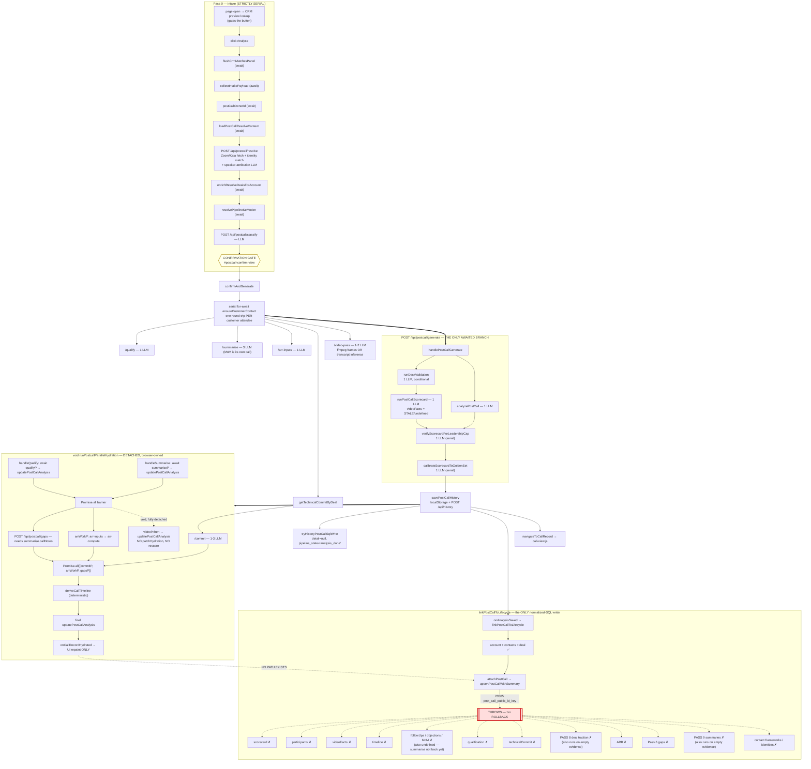

# 02 — Post-Call Dependency DAG

**Snapshot:** `SE-Labs` @ `c58eac93`, `VERSION` 2.1.30, 2026-09-08. **Evidence level:** CODE-PROVEN unless noted.
**Related:** [_evidence-index](_evidence-index.md) · [03-postcall-write-ledger](03-postcall-write-ledger.md) · [07-performance-and-cost](07-performance-and-cost.md) · [12-postcall-ux-zoom-and-loading](12-postcall-ux-zoom-and-loading.md)

---

## 1. The hypothesised schedule, corrected

The brief supplied an eight-point hypothesis. Verified line by line:

| # | Hypothesis | Verdict |
|---|---|---|
1 | Resolve and classify finish before the confirmation gate | **CONFIRMED.** `web/postcall.js:startPipeline:5551-5632`; strictly serial, `showConfirmationGate` is called after `await` on classify. `E-009`, `E-010` |
2 | On confirmation the browser starts qualification, summarisation, ARR-input extraction, prior-commit lookup/commit, and video work | **CONFIRMED**, with one addition the hypothesis missed: a **serial `for … await` loop creating customer contacts** runs *before* any of them. `E-011` |
3 | The browser separately awaits `/api/postcall/generate` | **CONFIRMED.** `web/postcall.js:4585` |
4 | Inside generate, narrative and scorecard run concurrently; deck validation may be nested before scorecard; verification and golden calibration run after the first scoring result | **CONFIRMED exactly.** `Promise.all([analyzePostCall, deckValidationPromise.then(runPostCallScorecard)])` at `generate.ts:154-181`, then `verifyScorecardForLeadershipCap` at `:196`, then `calibrateScorecardToGoldenSet` at `:229`. Verify and calibrate are **serial**, not parallel |
5 | After generate returns, the browser saves a history record, invokes `onAnalysisSaved`, and `web/app.js` calls `linkPostCallToLifecycle` using the initial generate response | **CONFIRMED.** `web/postcall.js:4622-4642`; `web/app.js:3221-3234`. `E-014` |
6 | The browser then launches `void runPostcallParallelHydration(...)` | **CONFIRMED.** `web/postcall.js:4661` |
7 | Hydration patches history as qualification/summarisation complete, then coordinates commit, ARR, gaps, timeline, and an independent video completion | **CONFIRMED.** `runPostcallParallelHydration:4715-5035` |
8 | It is not yet proven that hydrated data re-enters `linkPostCallToLifecycle`, Pass 8, Pass 9, normalized child writers, or a durable server-side finalizer | **NOW PROVEN — IT DOES NOT.** `setOnCallRecordHydrated` only calls `scheduleCallRecordPanelRefresh`, a UI repaint. `E-016` |

Two structural corrections the hypothesis did not anticipate:

- **`/api/postcall/generate` does not return `summarise`, `qualification`, `technicalCommit`, `pass6`, `arrCompute` or `timeline`** — its response is `{...narrative, scorecard, videoFacts, confirmed, analysisMeta}` (`generate.ts:269-287`, `E-013`). Therefore `linkPostCallToLifecycle`, which reads every child artefact off `data.*`, receives `undefined` for all of them on a first analysis. This is the mechanism behind F-002/F-003, not merely a timing detail.
- **`generateBody.videoFacts` is `pipelineState.videoFacts`, not the awaited `videoP`** (`E-012`), and `pipelineState.videoFacts` is only ever assigned inside the hydration `videoP.then` — i.e. *after* generate has already returned. On a first analysis it is always `undefined`.

## 2. The DAG

## 3. The three paths, separated

### 3.1 User-visible critical path (page open → first result on screen)

`CRM preview` → `Analyse` → `flushCrm` → `collectIntake` → `ownerId` → `resolveContext` → **`/resolve`** → `enrichDeals` → `seMotion` → **`/classify`** → *human confirm* → `contacts loop` → **`/generate` (deck → scorecard → verify → calibrate, with narrative in parallel)** → `savePostCallHistory` → `navigateToCallRecord`.

**6–7 LLM calls**, of which four (`scorecard` → `verify` → `calibrate`, plus `deck` before scorecard) are **strictly serial**. Nothing in the parallel batch shortens it.

### 3.2 Eventual-consistency path (what the user waits for after navigation)

`qualify ∥ summarise` → barrier → `gaps ∥ arr-compute` → barrier with `commit` → `deriveCallTimeline` → final patch → repaint. **9–11 further LLM calls.** Every write lands in the history blob only.

### 3.3 Finalization path

**There is none.** No server-side finalizer, no job record, no completion validation, no state beyond `pipeline_state = 'analysis_done'` written once at the very beginning. `E-033`, `E-063`.

## 4. Stage table

Columns: **T**=type (LLM/DET=deterministic/DB/VID/ORCH), **N**=provider invocations, **CP**=on critical path, **Await**=what it awaits, **Dest**=durable destination.

| Stage | Trigger / caller | Endpoint | Core impl | T | N | CP | Awaits | Awaited by | Abort / timeout | Failure mode | Retry | Idempotency key | In-memory | Local history | Remote history | `post_call.analysis` | `post_call.detail` | Normalized SQL | Read back by | Tests | Telemetry |
|---|---|---|---|---|---|---|---|---|---|---|---|---|---|---|---|---|---|---|---|---|---|
| CRM preview | `emailsEl` blur/input (**×2**, fw+native) | `resolveContactsForEmails` | `postcall-contact-resolve.js` | DB | 0 | **yes** (gates the button) | — | button enable | `crmMatchesToken` only | early-return keeps `crmResolving` semantics; panel hidden | none | — | `lastCrmMatchResult` | — | — | — | — | — | intake panel | `test-postcall-intake-preview.mjs` | none |
| Pass 0 resolve | `startPipeline` | `POST /api/postcall/resolve` | `postcall/resolve.ts` | ORCH+LLM | 0–1 (speaker-attribution) | **yes** | `ownerId`, `domainContextP` | classify | `AbortController` + `isPostcallPipelineStale` | throws → inline error; soft-fails Zoom **only if** a transcript was pasted | none | — | `pipelineState.resolve` (**incl. transcript**) | — | — | — | — | — | confirm gate | `test-postcall-resolve.ts` (mocked) | `activity_id` NULL — no `callId` sent |
| Pass 1 classify | `startPipeline` | `POST /api/postcall/classify` | `postcall/classify.ts` | LLM | 1 | **yes** | resolve, `seMotion` | confirmation gate | same | throws → inline error | none | — | `pipelineState.classify` | via `savePayload.callType` | same | `analysisMeta.callType` | — | `post_call.call_type` | gate + record | `test-classify-motion.ts` | `activity_id` NULL |
| **Confirmation gate** | `showConfirmationGate` | — | `web/postcall.js:4035` | ORCH | 0 | **yes — human wait** | classify | `confirmAndGenerate` | `abortPostcallPipeline` | — | — | — | `confirmGateAttendees` | — | — | — | — | — | — | `test-postcall-confirm.mjs` | — |
| Contact creation | `confirmAndGenerate` | `/api/domain-write` ×N | `ensureCustomerContact` | DB | 0 | **yes — blocks everything** | gate | all downstream | none | per-contact `try/catch`, warn only | none | contact publicId | — | — | — | — | — | `contact`, `deal_contact` | contacts view | `test-account-contact-dedupe.mjs` | — |
| Deck validation | inside generate | (nested) | `deck-validate.ts` | LLM | 0–1 | **yes** | deck upload | scorecard | 45 s (`extraction` — **misclassified**) | `.catch(() => null)` → deck treated valid | none | — | — | — | — | `analysisMeta.deckVerdict` | — | — | scorecard | `test-deck-validate.ts` | `activity_id` NULL |
| Narrative analysis | inside generate | (nested) | `postcall/analyze.ts` | LLM | 1 | **yes** | — | verify | 75 s | throws → generate fails | HTTP 429/503 ×2 | — | `data.analysis` | `rec.analysis` | same | **yes** | — | — | call view | `test-schema-drift.ts` | `activity_id` NULL |
| **Pass 3 scorecard** | inside generate | (nested) | `postcall/scorecard.ts` | LLM | **1** (no per-theme loop, `E-087`) | **yes** | deck validation | verify | 75 s | throws → generate fails | HTTP ×2 | — | `data.scorecard` | `rec.scorecard` | same | — | — | `scorecard`, `scorecard_line`, `scorecard_theme` — **only via `linkPostCallToLifecycle`, which fails** | QIP tab | `test-postcall-scorecard.ts` | `activity_id` NULL |
| Scorecard verify | after first score | (nested) | `scorecard-verify.ts` | LLM | 1 (+1 retry) | **yes** | scorecard | calibrate | **45 s — misclassified**, `E-100` | `catch` → `leadershipShareable=false` (fail-safe) | 1× on remote error | — | folded into `scorecard` | same | same | — | — | same | QIP tab | `test-scorecard-verify.ts` | `activity_id` NULL |
| Golden calibration | after verify | (nested) | `scorecard-calibrate.ts` | LLM | 1 (+1 retry) | **yes** | verify | generate return | **45 s — misclassified** | `catch` → keep verifier scores | 1× | — | folded in | same | same | — | — | same | QIP tab | `test-scorecard-calibrate.ts` | `activity_id` NULL |
| Pass 4 qualify | `confirmAndGenerate` (parallel) | `POST /api/postcall/qualify` | `qualify.ts` | LLM | 1 | no | gate | `Promise.all` in hydration | 75 s + abort | `.catch(() => null)` → `markError("qualify")` | none | — | `data.qualification` | `rec.result.qualification` | same | — | — | **never** (`E-016`) | MEDDPICC KPI | `test-postcall-qualify.ts` | `activity_id` NULL |
| Pass 7 summarise | parallel | `POST /api/postcall/summarise` | `summarise.ts` | LLM | **3** (`E-086`) | no | gate | gaps, `Promise.all` | 75 s | `.catch(() => null)` → `markError` | none | — | `data.summarise` | `rec.result.summarise` + `rec.analysis.callNotes` | same | **`callNotes` only** | — | **never** | notes, minutes, objections | `test-postcall-summarise.ts` | `activity_id` NULL |
| ARR inputs | parallel, then deferred | `POST /api/postcall/arr-inputs` | `arr-inputs.ts` | LLM | 1 | no | dealId+accountId | arr-compute | 75 s | `.catch(() => null)`, re-attempted in hydration | 1 deferred | — | `arrInputs` | `rec.result.arrInputs` | same | — | — | **never** | ARR module | `test-postcall-arr-inputs.ts` | `recordId` — **null on first run** |
| ARR compute | after inputs | `POST /api/postcall/arr-compute` | `arr-compute.ts` | **DET** | 0 | no | inputs + allowance | Pass 6 stamp | — | `.catch(() => null)` | none | — | `arrCompute` | `rec.result.arrCompute` | same | — | — | **never** | ARR module | `test-postcall-arr-compute.ts` | — |
| Pass 5 commit | parallel (after prior lookup) | `POST /api/postcall/commit` | `commit.ts` | LLM | 1–3 (parse ladder) | no | prior commit | `Promise.all` | 75 s | `.catch(() => null)` → `markError` | 2 app-level | — | `technicalCommit`, `tcDeltas` | `rec.result.*` | same | — | — | **never** | TC tab | `test-postcall-commit.ts` | `recordId` — null on first run |
| Pass 2 video | parallel | `POST /api/video-pass` | `video/pass2.ts` | LLM+VID | 1–2 | **no — and generate does not wait for it** | media/transcript | nothing (`void .then`) | ffmpeg 15 min / 5 min per window; **the transcript route has NO timeout** `E-099` | soft-fail → `pass2Debug.route="unavailable"` | 1× with refreshed URLs | — | `pipelineState.videoFacts` | `rec.result.videoFacts` | same | — | **only via the failing domain write** | **never** | stakeholders | `test-video-facts.ts` | **`call_pending_<ms>` → permanently orphaned** `E-064` |
| Pass 6 gaps | after summarise | `POST /api/postcall/gaps` | `gaps.ts` | LLM+EMB | 1 (+1 fallback) + **0–12 `embedContent`** | no | `summarise.callNotes` | timeline | 75 s gC; **embeddings have NO timeout** | `.catch(() => null)` → `markError` | 1 schema fallback | — | `pass6` | `rec.pass6`, `rec.result.pass6` | same | — | — | **never** | signal tab | `test-postcall-gaps.ts` | `activity_id` NULL |
| Timeline | after gaps | `POST /api/postcall/timeline` | `timeline.ts` | **DET** (`E-089`) | 0 | no | gaps, objections, scorecard lines | final patch | — | inside hydration `try` | none | — | `timeline` | `rec.result.timeline` | same | — | — | **never** | timeline strip | `test-postcall-timeline.ts` | — |
| **Pass 8 traction** | inside `linkPostCallToLifecycle` | `/api/domain-write` | `rollupDealTractionAfterPostCall` | DET | 0 | no | **nothing — runs with `qualification`/`summarise`/`technicalCommit` all `undefined`** `E-018` | — | — | `try/catch` warn | none | dealId | — | — | — | — | — | `deal_traction` — **unreached (rollback)** | deal health | `test-deal-traction.mjs` (fixtures) | — |
| **Pass 9 summaries** | inside `linkPostCallToLifecycle` | `/api/postcall/summaries` | `summaries.ts` | LLM | 1–2 | no | **same empty evidence** `E-019` | — | 75 s | `try/catch` warn | none | — | — | — | — | — | — | `deal_summary`, `account_summary` — **unreached** | account/deal view | `test-postcall-summaries.ts` | **structurally unattributable** `E-096` |
| Pass 9 batch | `/api/internal/batch/*` | — | `summaries-batch.ts` | LLM | 0 inline | no | — | — | — | — | — | — | — | — | — | — | — | — | — | `test-gemini-batch.ts` | — |
| Gap clustering | after Pass 6 persist | `/api/product-signal/cluster` | `product-signal/` | LLM | ≥1 | no | Pass 6 rows | — | — | `void` — fully detached | none | — | — | — | — | — | — | `signal_cluster` — **unreached** | signal view | `test-gap-cluster-engine.ts` | — |
| Read-model rebuild | `read-models-service.js:76` | `POST /api/read-models/schedule` | `routes/read-models.ts:33` | ORCH | 0 | no | — | — | — | **404 — route not registered** `E-044` | — | — | — | — | — | — | — | **never** | dashboards | none | — |

**Pass 9 batch and the nightly read-model rebuild are DEAD PATHS**: their routes are not in the route map (`E-045`), and `deploy/vps/cron-batch.sh` invokes them nightly against a 404.

## 5. Provider-invocation totals

| Segment | `generateContent` | `embedContent` | Notes |
|---|---|---|---|
Critical path (before first result) | **6–7** | 0 | 4 of them strictly serial |
Background hydration | **9–11** | 0–12 | |
**Total per normal post-call** | **15–18** | **up to 12** | ≈27–30 provider HTTP calls; up to ~24 gC with every retry. `E-090` |

## 6. Cancellation and failure branches

- **Abort**: `beginPostcallPipeline` mints `{signal, gen}`; `abortPostcallPipeline` bumps the generation and aborts the controller. `isPostcallPipelineStale(gen)` is checked at 13 points inside hydration. This part is well built.
- **What abort does NOT cover**: the 18 `safeEnrich` store reads in the call view (`E-071`), `scheduleCallRecordPanelRefresh` (`E-068`), `hidePrepGenOverlay`'s 420 ms fade, and `activePostcallProgress` closures (`E-076`).
- **Soft failure is the default**: every hydration branch is `.catch(() => null)` and every child write in `linkPostCallToLifecycle` is `try/catch`-and-warn. The parent record commits; the children silently do not. Catalogued in [06](06-bugs-and-risks.md) §H14.
- **Reload / navigation**: `pipelineState.resolve.transcript` lives only in module memory (`E-062`). A reload during hydration permanently strands gaps, timeline, ARR and the deferred commit — there is no resume, no unload handler, and no server-side job. `E-063`.

## 7. Unresolved

- Whether `speaker-attribution` runs on a given call depends on transcript cues; frequency is unmeasured.
- Real p50/p95 per stage — requires `ai_run`, which per `F-023` is ~0% attributable. See [07](07-performance-and-cost.md).
